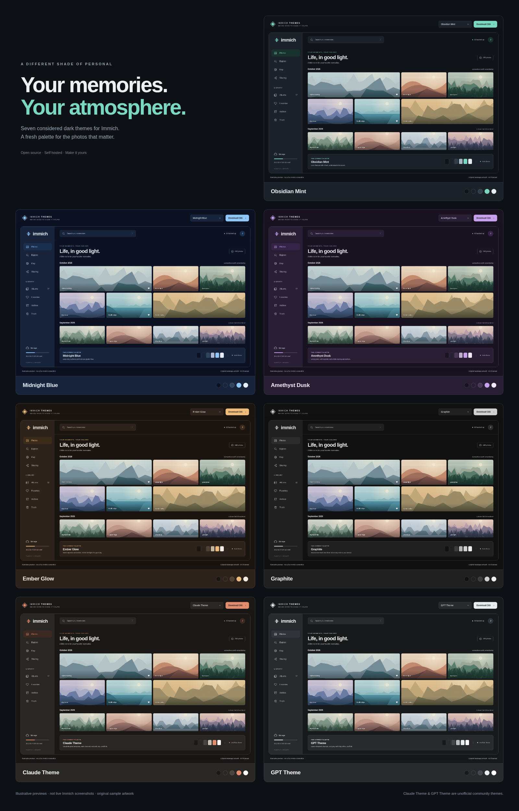
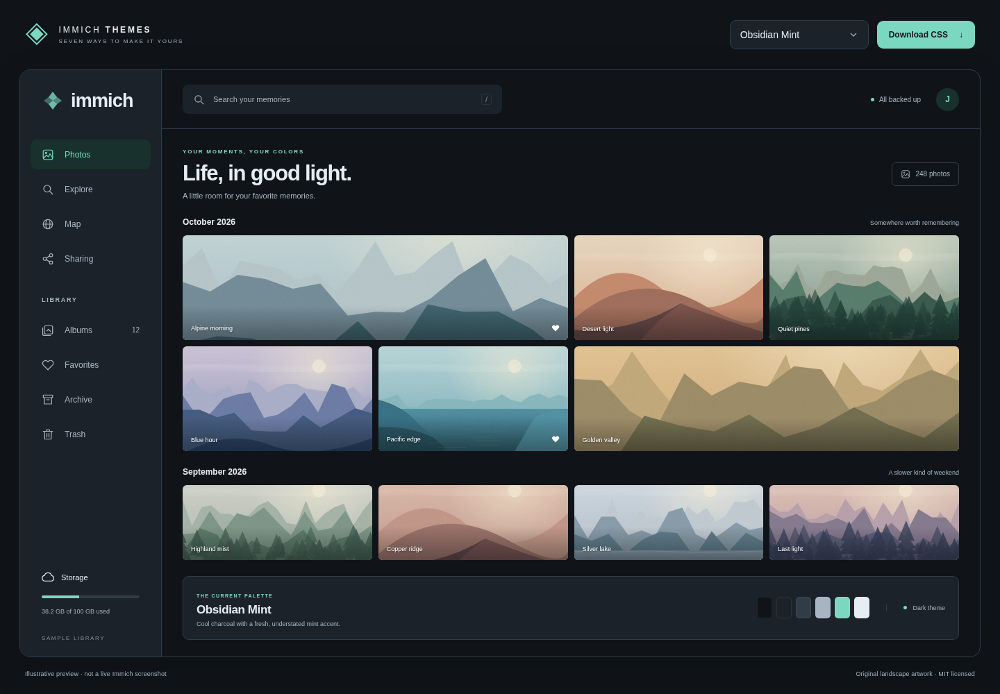
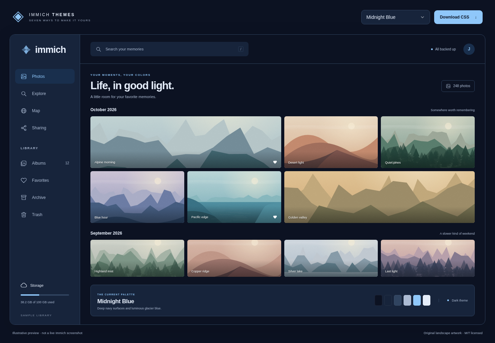
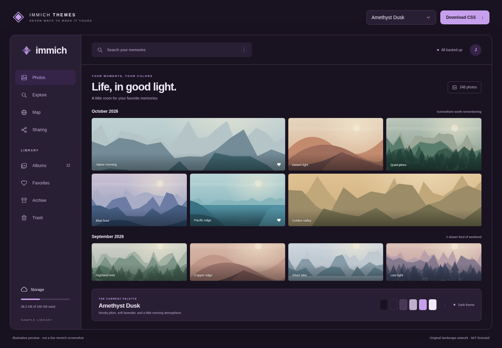
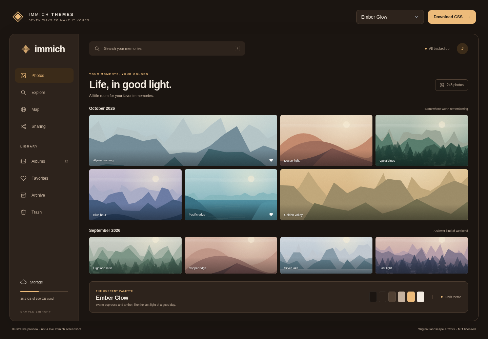
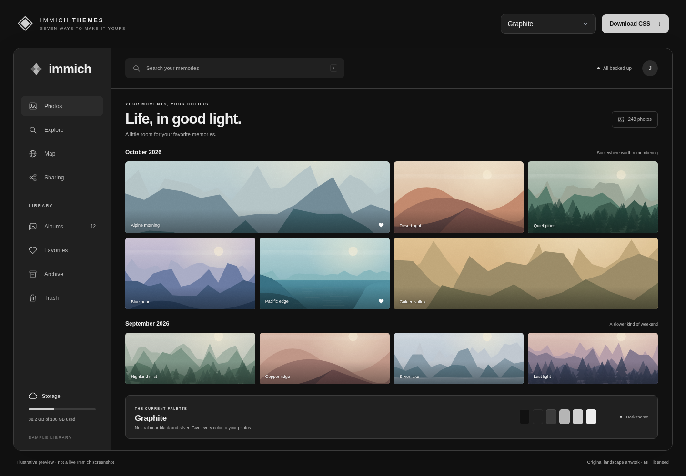
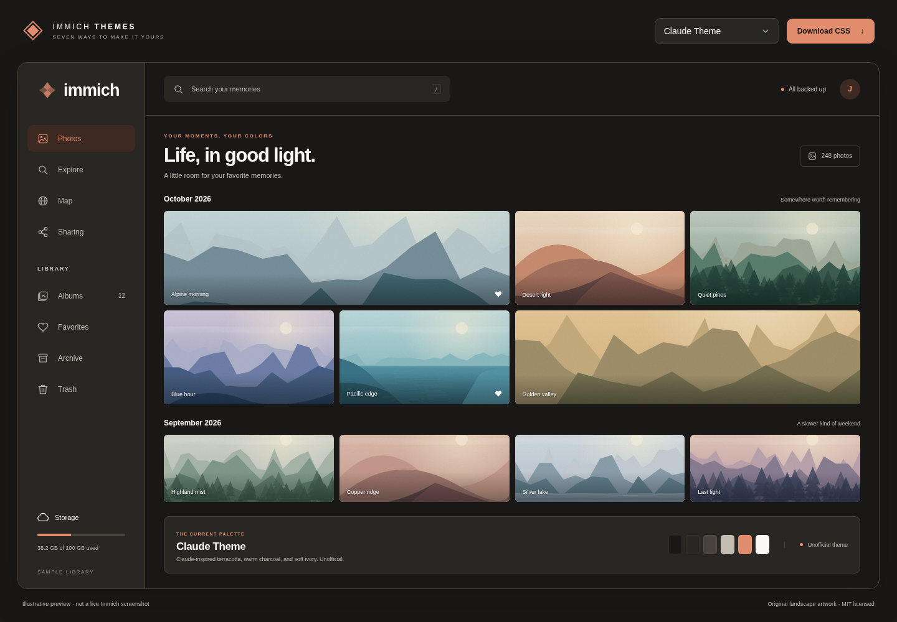
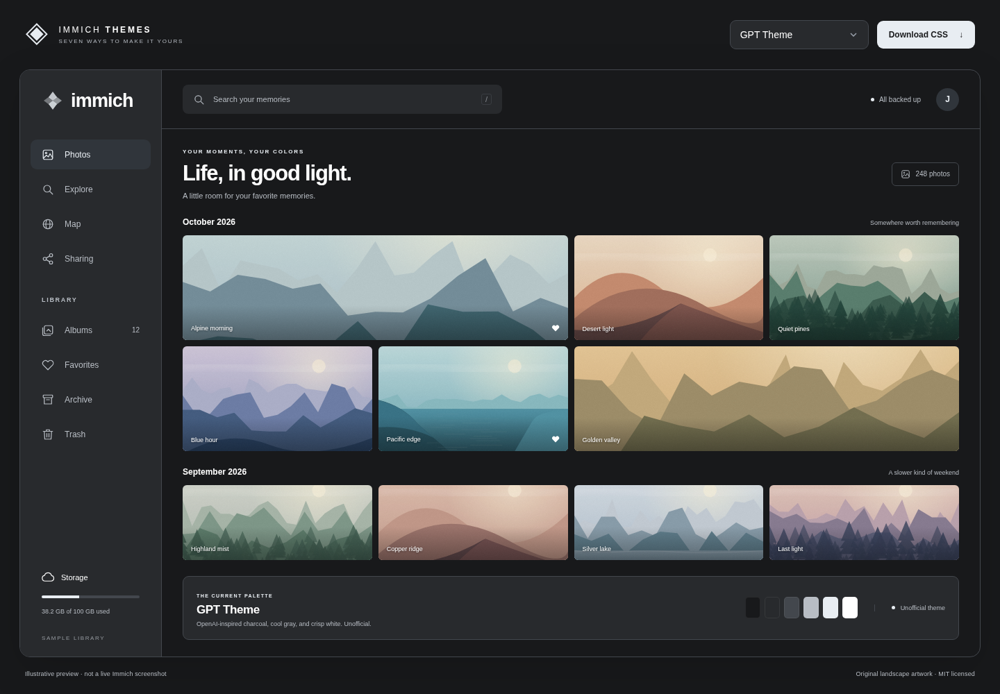

# ImmichCSS

**Seven dark themes. One CSS file. Your photos, in their own colors.**

A small collection of self-contained themes for the Immich web app: mint, blue, purple, amber, graphite, and two palettes inspired by Claude and OpenAI. Pick a theme, paste it into Custom CSS, and keep Immich's familiar layout.



The images are **illustrative previews**, rendered from the actual CSS with original sample artwork. They are not screenshots of a live Immich library. [Preview details](preview/README.md)

## Pick a theme

| Theme | Palette | CSS file | Examples |
| --- | --- | --- | --- |
| **Obsidian Mint** | Cool charcoal · fresh mint | [Download](https://raw.githubusercontent.com/YellowSnowman23/ImmichCSS/main/themes/obsidian-mint.css) | [Desktop](docs/images/obsidian-mint.png) · [Mobile](docs/images/obsidian-mint-mobile.png) |
| **Midnight Blue** | Deep navy · glacier blue | [Download](https://raw.githubusercontent.com/YellowSnowman23/ImmichCSS/main/themes/midnight-blue.css) | [Desktop](docs/images/midnight-blue.png) · [Mobile](docs/images/midnight-blue-mobile.png) |
| **Amethyst Dusk** | Smoky plum · lavender | [Download](https://raw.githubusercontent.com/YellowSnowman23/ImmichCSS/main/themes/amethyst-dusk.css) | [Desktop](docs/images/amethyst-dusk.png) · [Mobile](docs/images/amethyst-dusk-mobile.png) |
| **Ember Glow** | Warm espresso · amber | [Download](https://raw.githubusercontent.com/YellowSnowman23/ImmichCSS/main/themes/ember-glow.css) | [Desktop](docs/images/ember-glow.png) · [Mobile](docs/images/ember-glow-mobile.png) |
| **Graphite** | Neutral near-black · silver | [Download](https://raw.githubusercontent.com/YellowSnowman23/ImmichCSS/main/themes/graphite.css) | [Desktop](docs/images/graphite.png) · [Mobile](docs/images/graphite-mobile.png) |
| **Claude Theme** | Warm charcoal · terracotta · ivory | [Download](https://raw.githubusercontent.com/YellowSnowman23/ImmichCSS/main/themes/claude-theme.css) | [Desktop](docs/images/claude-theme.png) · [Mobile](docs/images/claude-theme-mobile.png) |
| **GPT Theme** | Charcoal · cool gray · crisp white | [Download](https://raw.githubusercontent.com/YellowSnowman23/ImmichCSS/main/themes/gpt-theme.css) | [Desktop](docs/images/gpt-theme.png) · [Mobile](docs/images/gpt-theme-mobile.png) |

Downloads open the complete stylesheet as plain text. You can also get every theme from the [latest release](https://github.com/YellowSnowman23/ImmichCSS/releases/latest).

Claude Theme and GPT Theme are unofficial color interpretations. Claude uses terracotta and ivory observed on Claude's website; GPT follows OpenAI's monochrome identity. Their dark surface ramps are adapted for Immich. [Palette sources and adaptations](docs/brand-inspiration.md)

## Install

No build, plugin, browser extension, or external font is needed.

1. Back up any existing Custom CSS.
2. Open one CSS file above and copy **all** of its contents.
3. In Immich, open **Administration → Settings → Theme Settings → Custom CSS**.
4. Replace the field with that stylesheet and save. Install **one theme at a time**.
5. Select **Dark** appearance in your Immich web client and refresh.

Custom CSS is an instance-wide setting, so it loads for all web users. These themes only apply in Dark appearance; each user keeps control of their appearance setting. They do not theme the native mobile apps.

To change themes, replace the stylesheet with another file. To uninstall, restore your earlier CSS (or clear the field if it was empty), save, and refresh. If an old palette remains, try a hard refresh. Configuration-file-managed instances should update `theme.customCss` through their existing configuration workflow.

## Compatibility

**Source-checked against Immich web v3.3.5 and `@immich/ui` 0.90.0.** Internal theme variables can change between Immich releases; other versions are not verified.

The themes cover native UI tokens, legacy RGB tokens, gray form fields, text selection, scrollbars, and keyboard focus. They preserve layout, photo/video colors, and Immich's semantic warning, success, and danger colors. There are no remote assets, imports, scripts, or `!important` overrides in the installable stylesheets.

Automated checks exercise the actual CSS in a small source-aligned browser fixture, including light/dark switching, fields, buttons, dialogs, focus, and unchanged sample image pixels. They also check the selected text/button color pairs against a 4.5:1 contrast target. This is not a full accessibility audit or an end-to-end test of a running Immich server. See [compatibility and validation](docs/compatibility.md) for sources and limits.

## Gallery

<details>
<summary>Obsidian Mint</summary>



</details>
<details>
<summary>Midnight Blue</summary>



</details>
<details>
<summary>Amethyst Dusk</summary>



</details>
<details>
<summary>Ember Glow</summary>



</details>
<details>
<summary>Graphite</summary>



</details>
<details>
<summary>Claude Theme (unofficial)</summary>



</details>
<details>
<summary>GPT Theme (unofficial)</summary>



</details>

## Preview and contribute

The committed `themes/*.css` files are ready to install. Node.js is only needed to develop or reproduce the previews.

```sh
git clone https://github.com/YellowSnowman23/ImmichCSS.git
cd ImmichCSS
npm ci
npx playwright install chromium
npm run check
npm run preview
```

Open `http://127.0.0.1:4173/preview/` to switch between all seven themes. The preview stays on your computer and uses only local files. Stop the server with Ctrl+C. On a Linux development machine missing browser libraries, use `npx playwright install --with-deps chromium` instead.

Edit `src/palettes.json`, then run:

```sh
npm run build
npm run check
npm run previews
```

This regenerates the installable CSS and desktop/mobile/overview PNGs. The browser renderer verifies that each stylesheet loads and that the preview has no horizontal overflow at the checked sizes. [Contributing guide](CONTRIBUTING.md)

## AI use disclosure

**GPT-6 Astra** was used to help create this project, including its theme CSS, documentation, preview assets, and validation scripts. See the [compatibility notes](docs/compatibility.md) for the scope and limitations of the testing performed.

## License and credits

Code, theme palettes, and original sample illustrations are released under the [MIT License](LICENSE). Immich, Claude, Anthropic, OpenAI, and GPT names belong to their respective owners. This independent community project is not affiliated with or endorsed by them. No company logos or proprietary fonts are bundled.
